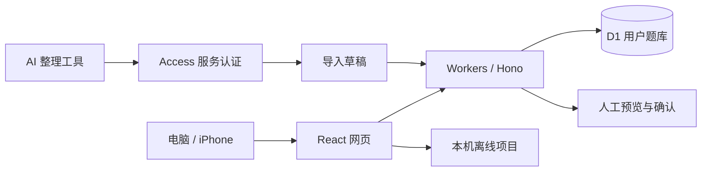

# 面试知识卡 · Interview Knowledge Cards

[](https://github.com/Wahuwahuuu/interview-knowledge-cards/actions/workflows/ci.yml)
[](https://github.com/Wahuwahuuu/interview-knowledge-cards/releases)
[](LICENSE)

把面试问答整理成按项目分类的知识卡，在电脑和 iPhone 上复习、改写答案，并用图谱找回问题之间的联系。

**v1.0.0** 提供账户密码登录、独立用户题库、人工维护、AI 导入草稿和项目离线复习。个人题库保存在数据库里，仓库只包含源码、配置模板和虚构的演示资料。

## 可以做什么

| 功能 | 使用方式 |
| --- | --- |
| 项目书架 | 按项目浏览卡片，搜索问题和答案，筛选知识点、重点、收藏与掌握状态 |
| 知识卡 | 问题、口述提纲、完整答案与重点属性；支持卡片／纯题目列表切换，标题和问题渲染 Markdown |
| 面试来源 | 同一道题记录多次出现，保留当时的问法、回答、公司、岗位和轮次 |
| 翻卡自测 | 全库或指定题库发问，支持顺序／随机切换、访问历史和手动掌握标记 |
| 知识图谱 | 参考 Obsidian 的白底灰色节点与细线，支持拖动节点、悬停关联、单击打开、滚轮缩放与自然收敛布局；显示和力参数可调 |
| 卡片维护 | 编辑、重点标记及删除；删除前弹窗二次确认，完整答案默认收起 |
| 导入问题 | 人工填写多道问答并预览确认，或下载 JSON 模板、上传文件自动解析；预览内嵌在记录中 |
| 备份与恢复 | 独立页面下载完整 JSON／Markdown 阅读版，上传完整备份后预览恢复 |
| AI 协作 | 受保护的机器接口查询管理员题库、提交草稿；AI 不能正式应用导入 |
| 私人账户 | 邮箱账号加密码注册，每人拥有独立题库；管理员控制用户启停和注册开关 |
| 离线复习 | 下载指定项目后，断网阅读、翻卡和查看图谱；修改需要联网 |

## 本机运行

需要 **Node.js 22.13+ 或 24 LTS** 和 npm。建议使用 Node.js 24；Cloudflare 账户只在部署上线时需要。

```sh
git clone https://github.com/Wahuwahuuu/interview-knowledge-cards.git
cd interview-knowledge-cards
npm ci
npm run setup
npm run build
npm run db:local
npm run preview
```

打开 <http://127.0.0.1:8787>。新数据库第一次显示管理员密码设置，默认本机管理员账号为 `admin@example.com`；这是独立的本机测试账户。随后在「维护与备份 → 导入问题」上传 [demo-import.json](examples/demo-import.json)，预览后确认，就能体验两个示例问题及一条追问关系。

Windows 也可以双击 **启动本地预览.cmd**；它会准备依赖、配置和数据库。关闭启动窗口即可停止预览。本机模式仅监听回环地址，不能作为手机共享或生产部署方式。

开发时使用 `npm run dev`。离线验证请使用构建后的 `npm run preview`，而非 Vite 开发页面。`npm run setup` 只创建缺失的配置，不覆盖已有部署。

## 部署到 Cloudflare

使用自己的 Workers、D1 和 Cloudflare Access，平台提供 `workers.dev` 网址。先从免费额度起步，额度与计费以自己的账户设置及 [Workers](https://developers.cloudflare.com/workers/platform/pricing/)／[D1](https://developers.cloudflare.com/d1/platform/pricing/) 官方说明为准。

1. 在 `wrangler.jsonc` 设置自己的 `OWNER_EMAIL`，授权部署工具。
2. 执行 `npm run deploy -- --bootstrap`，初始化独立 Worker、D1 和部署记录。
3. 配置 Access 管理员邮箱验证与单独的 AI 服务入口，再发布。
4. 管理员在网页亲自设置密码，随后将人工 Access 保护范围缩到 `/bootstrap-admin/*`，开放网站自己的登录和注册页。

完整命令、最小权限、手动配置方法与后续更新见 [部署指南](docs/deployment.md)。配置文件和部署身份记录都留在本机，不提交到仓库。Linux/macOS 可使用命令行运行和部署；Windows 提供额外的一键脚本及服务凭证加密保存。

## 账户与隐私

- 新用户注册后从空题库开始，卡片、来源、草稿、版本、导出和恢复都限定当前账户。
- 管理员拥有自己的题库，并可启停普通用户、开关注册；用户管理页不提供他人题库浏览。
- 密码使用随机盐 scrypt；会话 Cookie 为 HttpOnly、Secure、SameSite=Lax，服务器只保存会话凭证摘要。改密和停用会撤销旧会话。
- Access 邮箱验证仅用于管理员首次设置，普通用户使用账号密码。AI 使用独立服务凭证，绑定管理员题库。
- 切换账号或退出登录清理本机离线题库；离线退出先清理数据，联网后撤销旧会话。

普通用户邮箱目前只作为账号标识，v1.0 没有邮件验证或忘记密码找回流程。账户与密码、管理员用户管理位于左下角退出按钮左边的齿轮设置窗口，不再混在维护页面。账号操作说明见 [账户指南](docs/accounts.md)。

## 导入问题与 AI 协作

在「维护与备份 → 导入问题」选择现有题库或新建题库，填写标题、问题、复习提纲（口述版）和完整答案（详细讲解），可一次添加多道题。内部编号由程序生成，答案可以稍后补充。先生成预览，再由使用者确认导入；确认较早的预览不会清空之后继续填写的修改。切换导入与备份页面时保留填写内容。

JSON 是辅助入口：下载模板或上传 JSON 文件，程序自动解析后生成同样的导入预览。完整备份使用独立的「备份与恢复」页面，普通导入和完整恢复的记录分开展示。维护页不再单列面试来源，已有来源内容仍随题目与备份保留。

JSON v1 包含 `projects`、`topics`、`cards`、`sources`、`occurrences` 和 `relations`。`batch_id` 是稳定批次标识；相同批次重复提交不会生成重复卡片。所有引用需要存在于题库或同一批数据里。导入始终先预览，题库已更新时必须重新核对。

人工可以上传 JSON；配置独立机器凭证后，AI 可调用：

| 方法 | 接口 | 权限 |
| --- | --- | --- |
| GET | `/api/v1/agent/library` | 查询管理员当前题库，不返回历史快照 |
| GET | `/api/v1/agent/schema` | 查询 JSON Schema |
| POST | `/api/v1/agent/imports/preview` | 提交普通导入草稿 |
| GET | `/api/v1/agent/imports/{id}` | 查询批次状态与差异 |

机器凭证不能编辑正式卡片、管理用户、恢复题库或确认导入。普通用户可以让 AI 整理 JSON，登录自己的账号后上传。

详见 [格式与接口说明](docs/AI导入说明.md)、[AI 整理提示词](docs/AI整理提示词.md)、[演示文件](examples/demo-import.json) 和 [空白模板](examples/import-template-v1.json)。完整导出可恢复卡片、来源、关系和历史；操作见 [备份恢复](docs/backup-restore.md)。

点击「导入记录」中的一条记录，即在该记录下方展开预览，确认按钮、提示和错误也在同一框内；再次点击记录或「收起预览」可收起。新建预览也会进入对应记录并自动展开。

导入预览默认只展示需要审阅的题目内容：**标题、问题、复习提纲、完整答案**。答案按 Markdown 排版，修改已有内容时显示前后对照。知识点、来源、问题关联和系统字段收在「其他导入资料」中，通常无需逐项审阅。完整备份恢复仍会明确提示将被移除的题目和资料。所有题目默认收起，点击题目后才加载对应答案。打开待确认草稿时会自动刷新预览；如果审阅期间题库又发生变化，网站会在确认按钮旁提示重新核对并再次确认，避免覆盖新内容。导入失败也会在按钮旁持续显示原因。

首页「开始一轮复习」先选择「全库发问」或「按题库发问」，再选择出题方式。项目里的翻卡入口会预选该题库。顺序出题优先按标题开头的题号排列，没有题号时按稳定 ID 自然排序，保存掌握状态不会打乱顺序；全库按题库分组。随机出题在一轮内避免重复，上一题返回实际访问历史。复习中可随时切换方式，当前题保持不变，下一题按新方式发问。归档题不参与复习，离线时范围限于本机下载内容。左上页面名称可点击跳转。

知识卡详情中的「删除知识卡」会先打开独立确认弹窗，核对题目后点击「确认删除」才执行；取消、关闭或按 Esc 都不会删除。删除会清理该卡片的来源关联和问题连线，原始来源及其他题目保留，并更新当前设备已下载的副本。需要恢复时可使用删除前的完整备份。卡片不再显示版本号、历史浏览或恢复入口；完整答案默认收起，展开后才解析正文。

## iPhone 和离线

用 Safari 打开自己的部署地址，登录后通过分享菜单添加到主屏幕。进入项目，点击「下载项目」，看到成功提示后即可断网复习。

离线内容标明下载时间，需要更新时联网手动下载。离线不能修改答案、收藏、掌握状态或来源记录，也不会把未保存操作排队上传。步骤和检查清单见 [iPhone 使用指南](docs/ios.md)。

## 技术和目录

React + TypeScript + Vite 构建前端；Hono 运行于 Cloudflare Workers，D1 保存普通关系表；Canvas 绘制图谱，独立 Web Worker 使用 d3-force 计算布局，Service Worker 与 IndexedDB 保存页面外壳和用户选择的项目快照。



| 目录 | 内容 |
| --- | --- |
| `src/` | 页面、编辑器、图谱、账户及离线逻辑 |
| `worker/` | 登录授权、维护接口、D1 事务与版本冲突 |
| `shared/` | JSON 契约、数据校验、图谱和差异生成 |
| `migrations/` | 初始题库与多用户迁移，旧数据归属管理员 |
| `scripts/` | 配置、运行、部署、AI 导入与验证工具 |
| `examples/` | 虚构演示数据和导入模板 |
| `docs/` | 部署、账户、AI、备份、手机与验证说明 |

## 验证与发布

```sh
npm run build
npm test
npm run test:api
npm run test:accounts
```

接口验证使用独立本地 D1 数据库；账户测试自动生成虚构的旧版题库，检查迁移、隔离、登录、改密和用户管理，无需个人备份。线上检查为手动运行，需要自己的部署与授权；不会由 CI 自动发布网站。

v1.0 的桌面离线、原文保留、备份恢复、并发冲突、跨用户隔离和真实线上注册登录已完成验证。**iPhone 真机登录与离线复习仍需在实际设备完成验收**。详细记录与边界见 [验证说明](docs/validation.md)，版本说明见 [CHANGELOG](CHANGELOG.md) 与 [GitHub Releases](https://github.com/Wahuwahuuu/interview-knowledge-cards/releases)。

本版采用手动复习，尚未提供间隔重复算法、离线编辑同步或每用户独立 AI 凭证管理。

## 许可

采用 [MIT License](LICENSE)。
